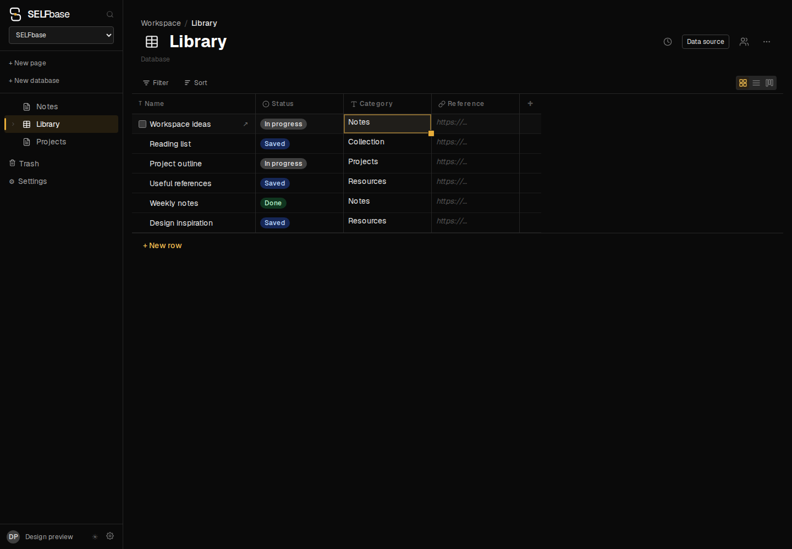

<h1 align="center">
  
  SELFbase
</h1>

<p align="center"><strong>Your notes, collections, and connected data. On your own server.</strong></p>

<p align="center">
  <a href="#getting-started">Get started</a> ·
  <a href="docs/EXTERNAL_DATA_SOURCES.md">Connect a source</a> ·
  <a href="docs/API_ENDPOINTS.md">REST API</a> ·
  <a href="docs/UPGRADES.md">Upgrade guide</a>
</p>

SELFbase is a self-hosted workspace for notes and structured collections. Build
personal databases with your own fields, connect records to external services,
and keep everything together in one place.

Every database row is also a page: open a record to write notes, attach files,
and add context. View the same collection as a grid, list, or board, with
real-time sync across clients.



## Make it your workspace

- **Write and organize** — nested pages, rich text, image/audio/code blocks,
  icons, breadcrumbs, and comments on pages or individual blocks.
- **Build your own collections** — custom columns, filters, sorting, and grid,
  list, or board views. Link databases with relations; use formulas, rollups,
  and column totals to work with your data.
- **Connect external services** — configure an HTTP JSON API, search for records
  from table cells, map source fields to your columns, and refresh linked rows
  in the background. [External data sources](docs/EXTERNAL_DATA_SOURCES.md).
- **Use your data elsewhere** — expose a database through a versioned REST API
  with API keys and an OpenAPI specification. [API guide](docs/API_ENDPOINTS.md).
- **Keep a history** — restore previous cell values and page snapshots, or
  recover deleted pages from the trash. Column type changes preview conversions
  before applying them. [Deletion and recovery](docs/DATA_LIFECYCLE.md).
- **Control access** — native email/password sign-in, optional OIDC, and
  per-page/per-block access rules with access requests and approval.
  [Access control](docs/ACCESS_CONTROL.md).
- **Bring your content along** — import a Notion Markdown + CSV export, upload
  files to S3-compatible storage, and export or restore a workspace snapshot.
  [Snapshot format and recovery](packages/snapshot-core/README.md).

<details>
<summary>Database fields and Notion import details</summary>

Supported fields: Text, Number, Date, Duration, Select, Multi-select, Checkbox,
URL, Relation, Person, File, Formula, and Rollup. Column footer calculations
include Sum, Average, Min, Max, Range, and Count, with settings stored per view.
Duration totals display as `Xh Ym`.

Import a Notion **export** from Settings → Import from Notion, or use the CLI
(`pnpm --filter web import:notion`). Choose one CSV and a folder of Markdown
files, select the title column, review inferred field types (`Text`, `Number`,
or `Select`), and preview the plan before importing. CSV rows become database
rows; a Markdown file whose title matches a row becomes its page body. Remaining
Markdown files become standalone pages.

The importer handles one database per run and refuses an existing database of
the same name. It runs client-side through the ordinary page/schema reducers;
a failed import can leave partial rows behind.

</details>

## Getting started

Prerequisites: Docker and Docker Compose. The prebuilt database module is
included in the repository; deploying does not require a Rust toolchain.

```bash
# 1. Configure
cp .env.example .env   # adjust S3 secrets (≥16 chars), URIs; host ports via
                       # SPACETIMEDB_HOST_PORT / WEB_HOST_PORT if defaults are taken

# 2. Start (the module WASM is committed at server/docker/server.wasm,
#    so no Rust toolchain is needed for deploy)
docker compose up -d --build
```

| Service | URL |
|---|---|
| SpacetimeDB | `http://localhost:3000` |
| Web client | `http://localhost:3001` |

Open the web client and register — the first user becomes admin.
`NEXT_PUBLIC_*` values are baked into the web bundle at build time; rebuild
the web image after changing them.

For an existing installation, follow [the upgrade and recovery procedure](./docs/UPGRADES.md).
The database is ready for the new web build only after publish and migrations
succeed. Existing running web containers must be stopped explicitly for upgrades.

## Stack

| Layer | Technology |
|---|---|
| Backend / sync | [SpacetimeDB](https://spacetimedb.com) (Rust module) |
| Frontend | Next.js · React 19 · Tailwind CSS 3 |
| Editor | Component-tree editor (`packages/pulp`) — typed `ComponentNode` rows in SpacetimeDB, per-block Yjs rich text |
| Auth | Native SpacetimeDB email/password (default) · Any OIDC provider (optional) |
| Attachments | S3-compatible storage (Garage in Docker Compose by default) |
| Containerisation | Docker Compose (3 services: SpacetimeDB, web, Garage) |

## Project structure

```
./
├── server/
│   ├── spacetimedb/src/   # Tables, reducers (lib.rs + modules)
│   ├── docker/            # entrypoint.sh, garage.toml, garage-init.sh
│   └── spacetime.json     # TS bindings output dir (web/src/module_bindings)
├── web/                   # Next.js app
├── packages/
│   ├── pulp/              # Component-tree editor library
│   └── snapshot-core/     # Snapshot v2 format (export/import)
├── extensions/            # (legacy, unused)
├── docs/                  # API_ENDPOINTS.md, ACCESS_CONTROL.md, security reviews
├── docker-compose.yml
└── pnpm-workspace.yaml
```

## Development (without Docker)

```bash
spacetime start

cd server/spacetimedb
cargo build --release --target wasm32-unknown-unknown
cd ..
# Use the pinned SpacetimeDB 2.0.3 CLI and the existing owner identity.
# Ignore local project defaults; migrations run only after publish succeeds.
spacetime publish --server http://127.0.0.1:3000 --no-config --break-clients --yes \
  --bin-path ./spacetimedb/target/wasm32-unknown-unknown/release/server.wasm selfbase &&
spacetime call --server http://127.0.0.1:3000 --no-config --yes selfbase run_pending_migrations

# new shell, repo root:
pnpm install
pnpm --filter @selfbase/web dev   # → http://localhost:3001
```

Point the dev web at your database in `web/.env.local`:

```env
NEXT_PUBLIC_SPACETIMEDB_URI=ws://localhost:3000
NEXT_PUBLIC_SPACETIMEDB_DB_NAME=selfbase
```

Notes for native runs:

- Blob routes call SpacetimeDB over HTTP for auth checks — set
  `SPACETIMEDB_INTERNAL_URL=http://localhost:3000` in the web process env.
- Without S3 (`S3_*` unset) uploads answer 503; everything else works.

Network limits apply to Docker and native runs alike: REST gateway and blob
permission checks allow 15 seconds per SpacetimeDB request, including response
reading. External-source responses allow 15 seconds and 2 MB. Proxied file
uploads accept at most 100 MiB of actual body data, even without a reliable
`Content-Length`, with a five-minute total deadline for receiving the file and
forwarding it to S3. Oversized uploads return 413; interrupted or expired uploads
return 408. Reverse proxies such as Caddy may impose additional limits.

After any change under `server/spacetimedb/src/`, regenerate bindings with
the **pinned CLI 2.0.3** (a newer host CLI rewrites the whole bindings
format — e.g. via the `clockworklabs/spacetime:v2.0.3` image):

```bash
cd server && spacetime generate
```

Then rebuild the module WASM and copy it to the committed prebuilt path
(`server/docker/server.wasm`), which is what the Docker deploy publishes:

```bash
cd server/spacetimedb
cargo build --release --target wasm32-unknown-unknown
cp target/wasm32-unknown-unknown/release/server.wasm ../docker/server.wasm
```

## Checks

Run `pnpm check` for unit tests, TypeScript and entrypoint checks, or
`pnpm check:all` for the complete regression run including disposable databases,
Chromium, Docker upgrades and production builds. See [TESTING.md](./docs/TESTING.md)
for prerequisites, individual profiles and execution details.

## Authentication

Default — native SpacetimeDB email/password, zero config. Optional — any OIDC
provider via `NEXT_PUBLIC_SPACETIMEAUTH_AUTHORITY` and
`NEXT_PUBLIC_SPACETIMEAUTH_CLIENT_ID` (Compose exposes these as
`SPACETIMEAUTH_AUTHORITY` and `SPACETIMEAUTH_CLIENT_ID`). Rebuild web after
changing them. As the module publisher, configure trust with
`set_oidc_trust_policy(issuer, audience)` using the provider's HTTPS issuer and
the expected client ID. The ID token must carry `email`, `name`, or
`preferred_username`. Configure this trust policy again after a snapshot restore.

## Backend API surface

Source of truth: `server/spacetimedb/src/` — all `#[reducer]` functions and
`#[table]` definitions. Groups: auth, pages & Yjs, component tree, snapshots,
attachments, database schema/values/views, access control, custom API
endpoints, snapshot import. Client call sites use generated bindings under
`web/src/module_bindings/`.

## Origins and license

SELFbase is a fork of [Pear](https://codeberg.org/Eclosion-Tech/pear), with the
fork point tagged `upstream-final`. It focuses on the workspace core: pages,
databases, relations, files, and APIs.

Upstream features outside this scope are not included: AI users and agent chats,
Orcha orchestration, MCP server/client, extensions, automations, semantic search,
AI columns, the device bridge, and the desktop app. SELFbase imports Notion
exports; it does not include Pear's server-side Notion API importer.

Licensed under [AGPL-3.0](LICENSE), the same license as Pear. Network use of a
modified version requires offering the corresponding source to users (§13).
