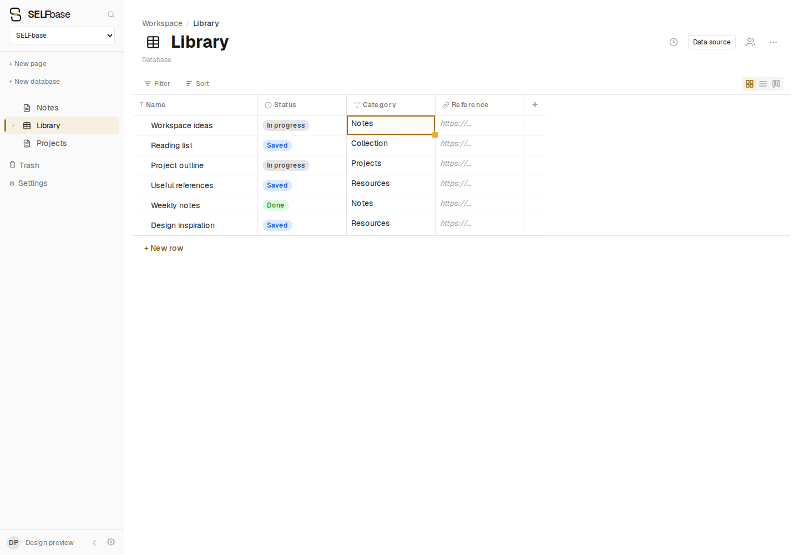

# SELFbase identity

The 01C mark combines two open page shapes and a small amber connection.
`BrandMark` renders it as an inline SVG with the surrounding text color;
`app/icon.svg` adapts to the browser's light/dark color scheme.
The wordmark uses Geist: semibold `SELF`, regular `base`.

The `accent` palette in `web/tailwind.config.ts` belongs to application
interactions: current navigation, selection, drag targets, focused controls,
view switches and primary actions. Light mode uses darker amber for small text
and focus outlines; gold controls use dark labels. Data/status colors,
user-selected content tones, avatars and URL cells keep their own palettes.

Bitmap fallbacks are generated from `web/app/icon.svg`:

```sh
node web/scripts/generate-brand-icons.cjs
```

This updates the 16/32/48px ICO and the 180px Apple icon. Keep the inline mark's
geometry aligned with the SVG when changing the symbol.

The screenshots show the running application with an isolated disposable
workspace and synthetic records, not a mockup or production user data.




Validation: 254 web unit tests, TypeScript, production Next.js build, and
Playwright checks against the production build (both themes, active navigation,
cell selection, keyboard focus and favicon delivery; no browser page errors).

## README gallery

The README uses four 1200 × 800 dark-theme screenshots from the running
production build: a database grid, an open record with properties and document
content, external-source search, and a board grouped by status. All records are
synthetic. Source search uses a local HTTP JSON example API through the real
integration endpoint; no personal services or credentials appear in the images.

- [Database](assets/preview-database.png)
- [Record page](assets/preview-page.png)
- [Source search](assets/preview-source.png)
- [Board](assets/preview-board.png)

The gallery was checked with Playwright and visually reviewed. The four views
loaded without browser page errors.
